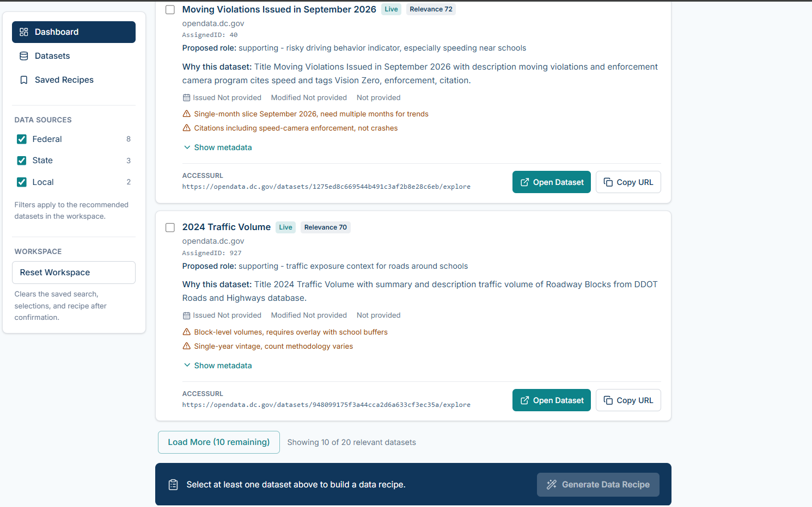
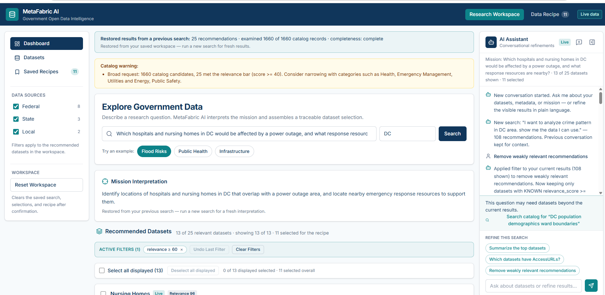
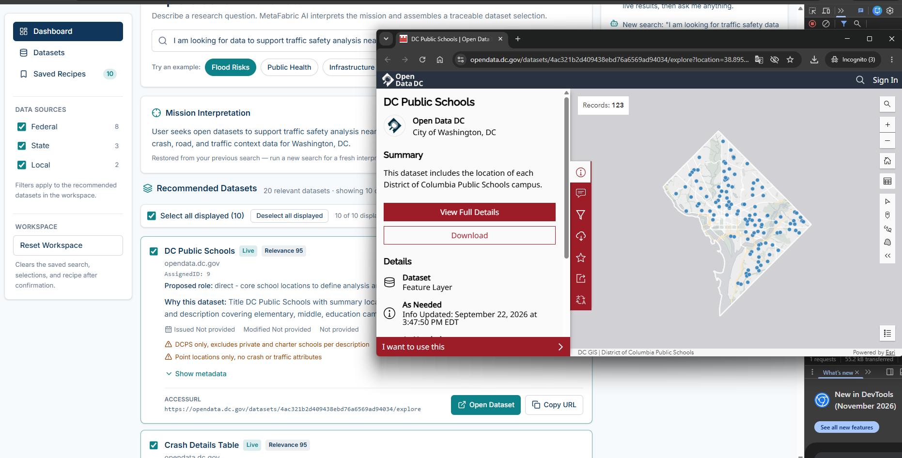
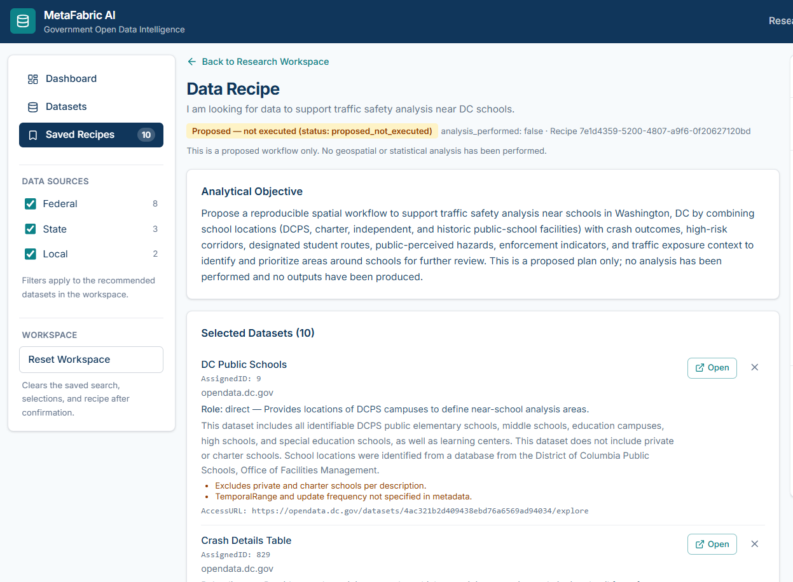
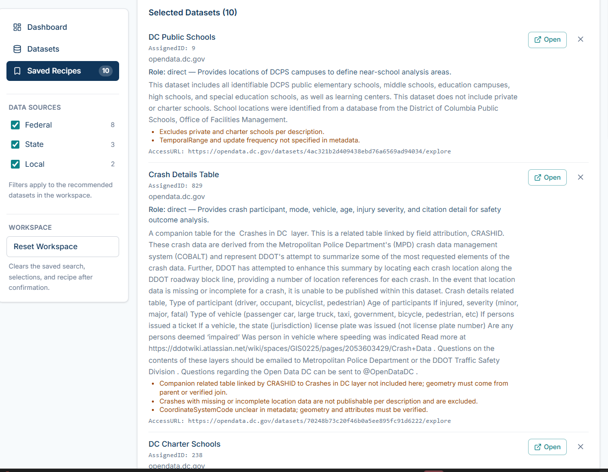
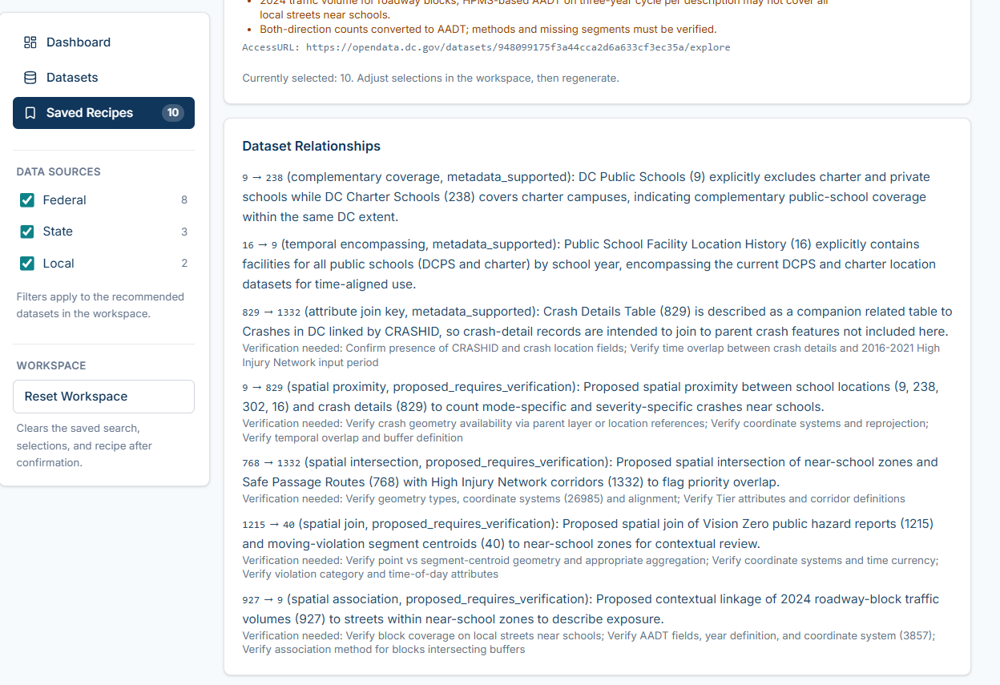
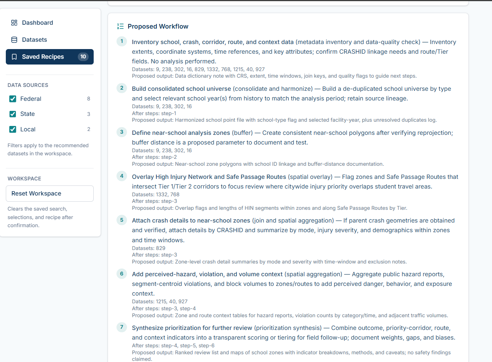
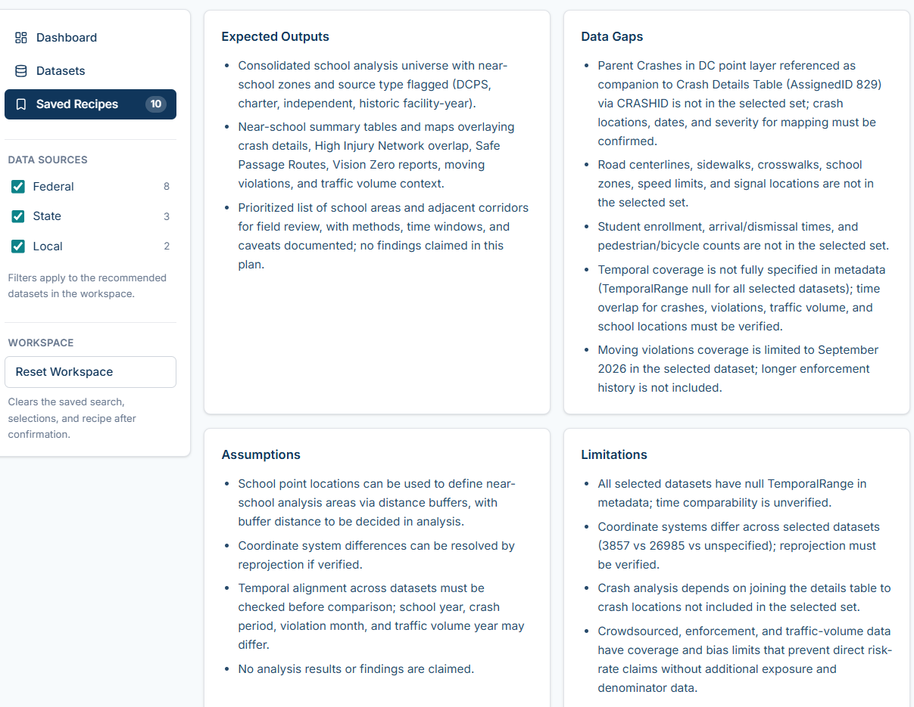

# MetaFabricAI

### A Data Discovery Revolution for the AI Era

**From a mission to the right data. From fragmented data sources to actionable Data Recipes.**

For decades, finding public data has meant typing keywords into dozens of separate government portals and hoping your words match the agency's terminology. The data exists, but people (and the AI systems that depend on it) can't find it.
Keyword search leaves users with seven problems:
1. It depends on perfect metadata, yet standards vary and fields are often incomplete.
2. It matches strings, not the meaning of titles, descriptions, or data dictionaries.
3. It can't turn a real-world mission into the data needed to address it.
4. Users must guess which keywords agencies use.
5. Natural-language questions don't work.
6. Nothing explains how datasets relate or how to combine them for analysis.
7. Data gaps stay invisible until deep into an analysis.
   
MetaFabric AI is a metadata-first, AI-assisted application that changes the starting point from *keywords* to *missions*. Users describe what they want to accomplish (for example, analyzing traffic safety near schools). Powered by Meta's **Muse Spark** model, MetaFabric interprets the mission, reasons over **every record** in a unified catalog of public metadata retrieved through an MCP service, recommends sources with explanations and caveats, supports conversational refinement, and proposes a **Data Recipe**: a structured plan for combining the selected datasets, including its own data gaps and limitations.

## Traditional search vs. MetaFabric AI

The same mission, tested on Washington, DC's official open-data portal and in MetaFabric AI:

> *"I am looking for data to support traffic safety analysis near DC schools."*

| Approach | Result |
| --- | --- |
| **opendata.dc.gov**, full sentence typed in | **No results found** |
| **opendata.dc.gov**, shortened to keywords "traffic safety and schools" | **2 results**, and both describe the same Automated Safety Cameras data |
| **MetaFabric AI** | **20 relevant datasets**, ranked and explained, then a 10-dataset Data Recipe covering schools, crashes, the High Injury Network, Safe Passage Routes, Vision Zero reports, moving violations, and traffic volume |

Results from a live session on November 3, 2026; counts may change as the portal and catalog are updated. A full record of the traditional search is in [docs/Traditional Data Search_DC_Traffic and schools.pdf](docs/Traditional%20Data%20Search_DC_Traffic%20and%20schools.pdf).

**MetaFabric AI: explained, ranked recommendations with caveats and live source links**



Why the difference? Keyword search matches words; missions need meaning. Traffic safety near schools draws on crash records, high-injury corridors, safe walking routes, enforcement data, and traffic volumes, and most of those datasets never mention the word "schools." Muse Spark connects the mission to the data by reasoning about what each dataset *is for*, not just what words it contains.

## Screenshots
### MetaFabric AI Main Page Layout
- **Left panel (Navigation):** Links to Dashboard, Datasets, and Saved Recipes, plus filters for Federal, State, and Local data sources and a Reset Workspace button.
- **Middle panel (Research Workspace):** Users enter a mission question and click **Search**. The AI interprets the question and returns a ranked list of candidate data layers, each with a relevance score and an explanation of why it was picked. Users select the layers they want, then click **Generate Data Recipe** at the bottom.
- **Right panel (AI Assistant):** A chat where users ask natural-language follow-up questions to filter or refine the results, such as *"remove weakly relevant datasets"* or *"which datasets have access URLs?"*

Every catalog record is examined (here, 1,660 of 1,660). The mission is interpreted in plain language, and the AI Assistant refines results conversationally.



Each recommendation links directly to the provider's real dataset:




### Data Recipe

| Recipe section | Screenshot |
| --- | --- |
| Analytical objective |  |
| Selected datasets |  |
| Dataset relationships |  |
| Proposed workflow |  |
| Data gaps, assumptions, and limitations |  |

Every recipe is labeled **"Proposed — not executed."** Instead of overclaiming, it surfaces what is missing, such as crash-location layers absent from the selection, null temporal ranges, and mismatched coordinate systems, so analysts know what to verify before starting.

> **Scope:** MetaFabric AI discovers and reasons over **metadata**, not copies of the underlying government datasets. A Data Recipe proposes sources, relationships, and analysis steps; it **does not execute** GIS analyses or establish that a real-world outcome has been proven. Dataset access and permissions remain with each data provider.

## System architecture


[Open the full-size architecture diagram](docs/MetaFabric%20AI%20System%20Architecture%20Infographic.png)

The architecture combines **three related GitHub repositories**. The harvester supplies standardized catalog metadata; the MCP server exposes that metadata to AI clients; and this repository contains the web experience and the backend AI workflows.

```text
Federal / state / local government open-data portals
                     |
                     v
     OpenDataHarvester (separate repository)
     Collect and normalize dataset metadata
                     |
                     v
       Standardized metadata catalog
                     |
                     v
     MetadataMCPServer (separate repository)
     Four MCP tools; Azure Container Apps
                     ^
                     | MCP over HTTPS
                     v
       MetaFabricAI / backend (FastAPI)
    MCP client + Meta Model API integration
    Discovery Agent / Recipe Agent / Assistant
                     ^
                     | /api HTTP requests
                     v
       MetaFabricAI / frontend (React)
       Mission search, dataset selection,
       conversational refinement, recipes
```

**Deployment clarification:** The MCP service is hosted in Azure Container Apps. The instructions below run the React and FastAPI application **locally**. The included infographic is a conceptual system diagram; it should not be interpreted as proof that every component is deployed in Azure.

### Related repositories and responsibilities

| Repository | Role | What it contributes |
| --- | --- | --- |
| **[MetaFabricAI](https://github.com/BruhWhosJoe/MetaFabricAI)** (this repository) | AI application and user experience | React/TypeScript web UI, FastAPI API, Meta Model API client, Discovery Agent, Recipe Agent, AI Assistant, testing and integration. |
| **[MetadataMCPServer](https://github.com/BruhWhosJoe/MetadataMCPServer)** | Metadata access layer | FastMCP server exposing metadata field discovery, catalog search/retrieval, and detailed dataset metadata through four MCP tools. Hosted separately in Azure Container Apps. |
| **[OpenDataHarvester](https://github.com/BruhWhosJoe/OpenDataHarvester)** | Metadata collection layer | Python harvesting and normalization tools for public open-data portal records; prepares the catalog used by the MCP service. |

**Running this application does not require rebuilding the harvester or running a local MCP server**, provided the configured Azure MCP endpoint is available. To rebuild or maintain the catalog or MCP service, consult the other repositories separately.

## Why mission-driven discovery?

Traditional portal search often assumes users know dataset titles, agency terminology, or geographic data structures. A mission such as *“What information would help identify neighborhoods facing flood vulnerability in Washington, DC?”* may require several kinds of data, each described differently and located in different portals.

MetaFabric AI uses Meta's models to relate the mission to available metadata, explain why specific records could be useful, support user refinement, and assemble proposed combinations into Data Recipes. It can be useful even when only titles, descriptions, summaries, access URLs, and other essential metadata fields are available; however, **better metadata generally leads to more trustworthy recommendations**.

The prototype's catalog has been reported to contain **1,660 metadata records**. This is catalog coverage, not the number of datasets downloaded or analyzed, and may change as the catalog is updated.

## Features

- **Mission-oriented search:** Enter a natural-language question instead of only dataset keywords.
- **Multi-source metadata discovery:** Search across normalized public-data records drawn from different portals.
- **Explainable recommendations:** Discover candidate datasets, with assigned identifiers and supporting metadata.
- **Conversational AI refinement:** Request additional filtering and update recommendations through the assistant.
- **Dataset selection and Data Recipes:** Choose dataset records and generate a structured, proposed workflow describing how they might be used together.
- **Source traceability:** Review metadata and source/access links supplied by the catalog.
- **Metadata-first approach:** Discover data without centralizing underlying records or bypassing the data provider's access rules.

### Future directions (not current features)

- Data-gap identification and a way for users to publish missing-data requests.
- Collaboration in which providers can respond to data-gap requests.
- Permission-aware discovery of internal metadata across agencies.
- Retention and evaluation of historical Data Recipes to improve later recommendations.

These are proposed extensions, not promises about current system behavior.

## Technology stack

| Layer | Technology |
| --- | --- |
| Frontend | React 19, TypeScript, Vite, Tailwind CSS, Lucide React |
| Backend | Python, FastAPI, Pydantic, Uvicorn |
| AI integration | Meta Model API; default `muse-spark-1.3` for all agents; `muse-wonder-1.0` optional (see below) |
| Metadata integration | FastMCP client, MCP over HTTPS |
| MCP hosting | Docker and Microsoft Azure Container Apps (separate repository) |
| Frontend tests | Vitest, Testing Library |
| Backend tests | pytest, pytest-asyncio |

### How Meta's models are used

- **Muse Spark 1.3** is the reasoning engine for all three backend agents (Discovery, AI Assistant, and Data Recipe), called through the Meta Model API Chat Completions endpoint with **strict JSON-schema structured output**. Its 1M-token context window lets the Discovery Agent evaluate the full catalog (about 160K tokens for 1,660 records) instead of a keyword-filtered shortlist.
- **Muse Wonder 1.0** was evaluated for recipe reasoning. Muse Spark delivered the quality the application needed at a much lower cost, so Spark is the default; Wonder remains available through `META_REASONING_MODEL` but is not called in the current version.
- **Muse Code** was used as an agentic development assistant while building the frontend and backend. This is distinct from invoking Meta models in the running backend.

## Repository structure

```text
MetaFabricAI/
├── README.md
├── .gitignore
├── docs/
│   ├── MetaFabric AI System Architecture Infographic.png
│   ├── Data Fabric Discovery Demo.html
│   ├── MainUI*.png, GeneratingDataRecipe1.png, DataRecipe*.png   # app screenshots
│   └── TraditonalOpenDataPortalSearch*.png, Traditional Data Search_*.pdf   # comparison
├── frontend/
│   ├── package.json
│   ├── vite.config.ts
│   ├── vitest.config.ts
│   └── src/                 # UI, pages, services, tests, components
└── backend/
    ├── .env.example        # configuration template (no real secret)
    ├── requirements.txt
    ├── README.md           # detailed backend guide
    ├── pytest.ini
    ├── app/
    │   ├── main.py         # app factory, CORS, API routing
    │   ├── config.py       # environment settings
    │   ├── agents/         # discovery, recipe, assistant
    │   ├── routers/        # API endpoint definitions
    │   ├── models/         # request and response models
    │   └── services/       # MCP and Meta model clients
    ├── scripts/            # MCP connectivity script
    └── tests/              # mocked automated API / agent tests
```

## Run locally (Windows PowerShell)

### Prerequisites

- Git
- Python **3.11 or newer** (the project has also been developed with Python 3.14)
- Node.js and npm compatible with the pinned frontend toolchain (prefer a current supported Node.js version; the existing frontend README describes Node.js 20+)
- Network access to the configured MCP service
- A valid **Meta Model API key** for live AI functionality

### 1. Clone the repository

```powershell
cd C:\Projects
git clone https://github.com/BruhWhosJoe/MetaFabricAI.git
cd C:\Projects\MetaFabricAI
```

If you already have the repository at `C:\Projects\MetaFabricAI`, do **not** clone it a second time. Instead, open that directory and use `git pull` after committing or backing up local changes.

### 2. Create the project-level Python environment and install dependencies

Run these commands from `C:\Projects\MetaFabricAI`:

```powershell
# Create once (skip if .venv already exists)
python -m venv .venv

# Install backend dependencies using the venv interpreter directly
.\.venv\Scripts\python.exe -m pip install --upgrade pip
.\.venv\Scripts\python.exe -m pip install -r backend\requirements.txt

# Create a local settings file from the safe template
Copy-Item backend\.env.example backend\.env
```

If you prefer activation, run `.\.venv\Scripts\Activate.ps1`. If the shell blocks that script, you can continue using the explicit `.venv\Scripts\python.exe` commands above without changing PowerShell execution policy.

### 3. Configure the backend

Open `backend\.env` and set `MODEL_API_KEY` to your **own authorized key**. Example (placeholders only):

```dotenv
MCP_SERVER_URL=https://ca-metadata-mcp-dev.wittyforest-26c063ae.eastus.azurecontainerapps.io/mcp
MCP_TIMEOUT_SECONDS=60
MODEL_API_KEY=replace_with_your_real_key_locally
META_MODEL=muse-spark-1.3
META_REASONING_MODEL=muse-wonder-1.0
META_API_BASE_URL=https://api.meta.ai/v1
```

The sample endpoint is the development service configured by this repository and may be stopped or changed. The `.env.example` file documents additional settings, including pagination and token budgets. The current MCP catalog page size must remain **500 or less** unless the remote server is reconfigured accordingly.

**Security:** Never commit `backend/.env`, real API keys, access tokens, or restricted metadata. The API key belongs only in the server-side backend. Do not place it in frontend code or a `VITE_` variable.

### 4. Start the FastAPI backend (Terminal 1)

```powershell
cd C:\Projects\MetaFabricAI\backend
..\.venv\Scripts\python.exe -m uvicorn app.main:app --reload --host 127.0.0.1 --port 8000
```

Open:

- Health: <http://127.0.0.1:8000/api/health>
- MCP connection: <http://127.0.0.1:8000/api/mcp/health>
- Interactive API documentation: <http://127.0.0.1:8000/docs>

The backend must remain running while you use the frontend. Press **Ctrl+C** in this terminal to stop it.

### 5. Start the React frontend (Terminal 2)

```powershell
cd C:\Projects\MetaFabricAI\frontend
npm ci
npm run dev -- --host 127.0.0.1 --port 5173
```

Open <http://127.0.0.1:5173>. The Vite configuration proxies requests beginning with `/api` to the local backend at `http://127.0.0.1:8000`, so both terminals should be running.

## Verify the setup and test the project

### A. Basic health checks (Terminal 3)

```powershell
Invoke-RestMethod http://127.0.0.1:8000/api/health
Invoke-RestMethod http://127.0.0.1:8000/api/mcp/health
```

The first endpoint checks that FastAPI is running. The second makes a **live network request** to the configured MCP service and should report the available tools. If it returns HTTP 503, check the MCP endpoint, network, and whether the Azure service is running.

The four MCP tools documented for this system are:

1. `get_metadata_fields` — discover available search metadata fields.
2. `get_metadata_field_definitions` — retrieve field descriptions/definitions.
3. `get_metadata_catalog` — retrieve/search catalog records with pagination.
4. `get_layer_metadata` — retrieve detailed metadata for selected dataset IDs.

### B. Automated backend tests (mocked, no live Azure dependency)

```powershell
cd C:\Projects\MetaFabricAI\backend
..\.venv\Scripts\python.exe -m pytest tests -v
```

The backend suite includes health, MCP client, discovery, recipe, assistant, and UI integration-contract tests. Most external dependencies are mocked; consult individual tests before enabling any explicitly opt-in live integration checks.

### C. Automated frontend tests, lint, and build

```powershell
cd C:\Projects\MetaFabricAI\frontend
npm test
npm run lint
npm run build
```

`npm test` uses Vitest, `npm run lint` uses Oxlint, and `npm run build` runs TypeScript checking and bundles the production frontend. These tests do not substitute for a full live AI/MCP smoke test.

### D. Live MCP connectivity script

```powershell
cd C:\Projects\MetaFabricAI\backend
..\.venv\Scripts\python.exe scripts\test_mcp_connection.py
```

This checks the live MCP tools and retrieves a small catalog sample. It requires the remote MCP server to be accessible.

### E. End-to-end manual demonstration

1. Confirm both the frontend and backend are running, and `/api/mcp/health` succeeds.
2. In the web application, ask a mission-oriented question, for example: **“Which government datasets could help identify flood-vulnerable neighborhoods in Washington, DC?”**
3. Examine recommended datasets, AssignedIDs, explanations, and source/access URLs.
4. Ask the AI Assistant to refine the recommendations (for example, exclude a clearly irrelevant dataset) and verify the recommendation list updates.
5. Select relevant datasets and generate a Data Recipe.
6. Confirm that the recipe cites actual selected dataset IDs and shows a **proposed** workflow, without claiming that spatial analysis has already been performed.

For direct API requests, use the interactive OpenAPI documentation at <http://127.0.0.1:8000/docs> to see the current request schemas.

### Main API endpoints

| Endpoint | Function |
| --- | --- |
| `GET /api/health` | FastAPI health check |
| `GET /api/mcp/health` | Connect to MCP and enumerate tools |
| `POST /api/discovery/search` | Mission-aware discovery and dataset ranking |
| `POST /api/recipe/generate` | Proposed Data Recipe for selected AssignedIDs |
| `POST /api/assistant/chat` | Metadata-aware conversational refinement |
| `GET /docs` | Swagger / OpenAPI UI |

## Troubleshooting

| Symptom | What to check |
| --- | --- |
| The frontend opens but live search fails | Verify both terminals are running and that the backend is reachable on port 8000. |
| `/api/mcp/health` returns `503` | The Azure MCP service, its URL, or network access may be unavailable. Run the live MCP test script. |
| `model_not_configured` | Add a valid `MODEL_API_KEY` to `backend/.env` and restart the backend. |
| `model_error` / HTTP `502` | Check Meta API access, selected model, response formatting, and account limits. |
| `ModuleNotFoundError: app` | Launch Uvicorn and pytest from the `backend` directory. |
| Port 5173 or 8000 is in use | Stop the other process with Ctrl+C; update the proxy if the backend port changes. |
| PowerShell activation blocked | Use the explicit `.venv\Scripts\python.exe` commands provided above. |
| Recipe returns an unknown dataset error | Verify the selected AssignedIDs are present in the configured catalog. |

## Data access, trust, and limitations

- **Discovery is not access authorization.** Dataset providers determine access permissions, terms, and how to request restricted data.
- Catalog information is metadata; MetaFabric AI does not ingest all underlying datasets into a central store.
- Recommendations depend on the completeness and correctness of source metadata and on model reasoning; users should verify source relevance and availability.
- The recipe represents a **proposed analysis plan**. It does not execute joins, calculate risk scores, or validate causal claims.
- Future use with nonpublic agency metadata would require authentication, authorization-aware retrieval, audit controls, and protection of sensitive metadata.

## Development and acknowledgments

Created for attending **Meta Global AI Developer Hackathon**. Meta Muse models are integrated through the Meta Model API, while Muse Code assisted the implementation workflow. The project uses React, Python, FastAPI, FastMCP, Docker, and Azure components as described above.
See the linked repositories for the metadata collection and MCP service implementations. 
This project is developed by [Jonathan Wang on LinkedIn](https://www.linkedin.com/in/jonathan-wang-228366365/).


**In the AI era, reliable data is the foundation of reliable intelligence. MetaFabric AI helps people discover the right data for the missions that matter.**

Copyright © 2026 Jonathan Wang. All rights reserved.
---

